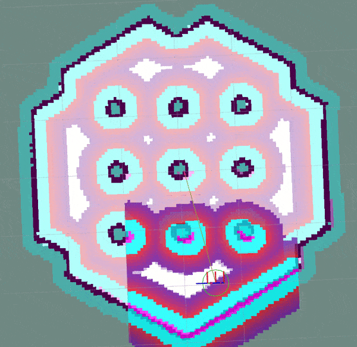

# Model Predictive Path Integral Controller



## Overview

This is a predictive controller (local trajectory planner) that implements the [Model Predictive Path Integral (MPPI)](https://ieeexplore.ieee.org/document/7487277) algorithm to track a path with adaptive collision avoidance. It contains plugin-based critic functions to impact the behavior of the algorithm. It was created by [Aleksei Budyakov](https://www.linkedin.com/in/aleksei-budyakov-334889224/) and adapted & developed for Nav2 by [Steve Macenski](https://www.linkedin.com/in/steve-macenski-41a985101/).

This plugin implements the ``nav2_core::Controller`` interface allowing it to be used across the navigation stack as a local trajectory planner in the controller server's action server (``controller_server``).

This controller is measured to run at 50+ Hz on a modest Intel processor (4th gen i5). See its Configuration Guide Page for additional parameter descriptions.

It works currently with Differential, Omnidirectional, and Ackermann robots.

## MPPI Description

The MPPI algorithm is an MPC variant that finds a control velocity for the robot using an iterative approach. Using the previous time step's best control solution and the robot's current state, a set of randomly sampled perturbations from a Gaussian distribution are applied. These noised controls are forward simulated to generate a set of trajectories within the robot's motion model.

Next, these trajectories are scored using a set of plugin-based critic functions to find the best trajectory in the batch. The output scores are used to set the best control with a soft max function.

This process is then repeated a number of times and returns a converged solution. This solution is then used as the basis of the next time step's initial control.

## Features

- Predictive MPC trajectory planner
- Utilizes plugin-based critics which can be swapped out, tuned, or replaced easily by the user
- Highly optimized CPU-only performance using vectorization and tensor operations
- Supports a number of common motion models, including Ackermann, Differential-Drive, and Omni-directional
- Includes fallback mechanisms to handle soft-failures before escalating to recovery behaviors
- High-quality code implementation with Doxygen, high unit test coverage, documentation, and parameter guide
- Easily extensible to support modern research variants of MPPI
- Comes pre-tuned for good out-of-the-box behavior

## Configuration

### CostCritic 并行调度

CostCritic 固定使用 OpenMP dynamic 调度评估轨迹。`num_threads: 1` 保持串行执行，
用于确定性基线和低负载场景；大于 1 时使用
`schedule(dynamic, chunk_size)`，将重负载轨迹继续分发给先完成的线程。所有模式共享
同一评分逻辑；benchmark 会用串行执行结果校验成本向量和 `fail_flag`。

可配置的调度参数只有：

- `CostCritic.num_threads`：OpenMP worker 数；设为 `1` 时串行。
- `CostCritic.chunk_size`：每次动态领取的轨迹数；不均匀碰撞负载建议保持 `1`。

构建并运行 benchmark：

```bash
colcon build --packages-select finenav_collision_model finenav_mppi_controller \
  --cmake-args -DBUILD_BENCHMARKS=ON -DCMAKE_BUILD_TYPE=Release
source install/finenav_collision_model/share/finenav_collision_model/package.bash
source install/finenav_mppi_controller/share/finenav_mppi_controller/package.bash
./build/finenav_mppi_controller/benchmark/cost_critic_benchmark \
  --benchmark_filter='BM_CostCriticHeavy/' \
  --benchmark_min_time=0.05 \
  --benchmark_repetitions=10 \
  --benchmark_report_aggregates_only=true
```

真实重负载使用连续代价栅格、OBB 棱线采样和连续排列的早/中/晚碰撞轨迹。当前主机
的 `5000 x 56`、8 线程实验中，OpenMP dynamic 达到 `6.69x` 加速；动态调度避免了
连续重轨迹在静态分块时造成的线程空闲。完整数据和环境记录保存在
`/home/fins/Desktop/finenav_engine_design_docs/`，不属于仓库提交内容。

### 可视化崩溃排查后的构建要求

可视化诊断数据使用纯 STL `float` 容器保存 critic 贡献，避免 Eigen 动态数组在共享库
版本不一致时参与释放。修改头文件后必须同时重编译 MPPI 库和 demo；工作区存在外层
`/home/fins/Desktop/finenav_engine/{build,install}` 与源码目录下的
`FineNav-Engine/{build,install}` 两套产物，运行日志中的可执行文件路径必须与重新编译的
install 空间一致。推荐始终从外层工作区执行：

```bash
cd /home/fins/Desktop/finenav_engine
source /opt/ros/humble/setup.bash
source /home/fins/Desktop/generate_parameter_library/install/setup.bash
colcon build --packages-select finenav_mppi_controller finenav_demo
source install/setup.bash
```

不要只编译单个测试目标或混用两套 `install`；这会让新头文件与旧共享库的
`CriticCostBreakdown` 布局不一致，表现为 reset 阶段的 `double free or corruption`。

### Ackermann 约束与参数更新同步

Ackermann `ConstraintCritic` 对角速度使用 `max(abs(wz), 1e-6)`，避免静止轨迹
出现 `0/0` 并污染 MPPI 代价。控制序列约束遵循 Nav2 `#6072` 的顺序：先应用
Ackermann 转弯半径，再按反馈速度和加速度限制逐点投影，最后再次应用专用运动学
约束；当两类约束冲突时，以车辆运动学可行性优先。

MPPI 控制器内部的 `configure()`、`reset()` 和 `plan()` 共用一把互斥锁。动态参数
回调重建 Critic、Optimizer 或 Visualizer 时会等待当前规划完成，规划期间不会访问
已被重建的对象；CostCritic 自身的 OpenMP dynamic 并行不受影响。

### Controller
 | Parameter                  | Type   | Definition                                                                                                                                                                                                                                                                                                           |
 | ---------------------      | ------ | -------------------------------------------------------------------------------------------------------- |
 | motion_model               | string | Default: DiffDrive. Type of model [DiffDrive, Omni, Ackermann].                                          |
 | critics                    | string | Default: None. Critics (plugins) names                                                                   |
 | iteration_count            | int    | Default 1. Iteration count in MPPI algorithm. Recommend to keep as 1 and prefer more batches.            |
 | batch_size                 | int    | Default 1000. Count of randomly sampled candidate trajectories                                            |
 | time_steps                 | int    | Default 56. Number of time steps (points) in each sampled trajectory                                     |
 | model_dt                   | double | Default: 0.05. Time interval (s) between two sampled points in trajectories.                              |
 | vx_std                     | double | Default 0.2. Sampling standard deviation for VX                                                          |
 | vy_std                     | double | Default 0.2. Sampling standard deviation for VY                                                          |
 | wz_std                     | double | Default 0.4. Sampling standard deviation for Wz                                                          |
 | vx_max                     | double | Default 0.5. Max VX (m/s)                                                                                |
 | vy_max                     | double | Default 0.5. Max VY in either direction, if holonomic. (m/s)                                             |
 | vx_min                     | double | Default -0.35. Min VX (m/s)                                                                              |
 | wz_max                     | double | Default 1.9. Max WZ (rad/s)                                                                              |
 | ax_min                     | double | Default -1.0. Minimum longitudinal acceleration (m/s^2), must be <= 0.                              |
 | ax_max                     | double | Default 1.0. Maximum longitudinal acceleration (m/s^2), must be >= 0.                               |
 | ay_min                     | double | Default -1.0. Minimum lateral acceleration (m/s^2), used by Omni.                                    |
 | ay_max                     | double | Default 1.0. Maximum lateral acceleration (m/s^2), used by Omni.                                     |
 | az_max                     | double | Default 3.0. Symmetric yaw acceleration limit (rad/s^2).                                             |
 | temperature                | double | Default: 0.3. Selectiveness of trajectories by their costs (The closer this value to 0, the "more" we take in consideration controls with less cost), 0 mean use control with best cost, huge value will lead to just taking mean of all trajectories without cost consideration                                                   |
 | gamma                      | double | Default: 0.015. A trade-off between smoothness (high) and low energy (low). This is a complex parameter that likely won't need to be changed from the default of `0.1` which works well for a broad range of cases. See Section 3D-2 in "Information Theoretic Model Predictive Control: Theory and Applications to Autonomous Driving" for detailed information.       |
 | visualize                  | bool   | Default: false. Publish visualization of trajectories, which can slow down the controller significantly. Use only for debugging.                                                                                                                                       |
 | retry_attempt_limit        | int    | Default 1. Number of attempts to find feasible trajectory on failure for soft-resets before reporting failure.                                                                                                                                                                                                       |
| reset_period            | double    | Default 1.0. required time of inactivity to reset optimizer  (only in Humble due to backport ABI policies)            |
 | regenerate_noises          | bool   | Default true. Whether to regenerate noises asynchronously for each optimization iteration or use a single noise distribution computed on initialization and reset. |

#### Trajectory Visualizer
 | Parameter                       | Type   | Definition                                                                                                      |
 | ------------------------------ | ------ | --------------------------------------------------------------------------------------------------------------- |
 | visualize                      | bool   | Default: false. Enable the optional publisher-only MPPI visualizer.                                            |
 | visualizer_node_name           | string | Default: finenav_mppi_visualizer. Private ROS node name owned by MPPI.                                         |
 | visualizer_frame_id            | string | Default: map. Frame assigned to all visualization messages.                                                    |
 | visualizer_trajectory_topic    | string | Default: /mppi_debug/trajectories. Candidate MarkerArray topic.                                                |
 | visualizer_optimal_path_topic  | string | Default: /mppi_debug/optimal_trajectory. Optimized nav_msgs/Path topic.                                        |
 | visualizer_reference_path_topic| string | Default: /mppi_debug/reference_path. Reference nav_msgs/Path topic.                                            |
 | visualizer_trajectory_step     | int    | Default: 5. Batch stride used to downsample candidate trajectories.                                            |
 | visualizer_time_step           | int    | Default: 3. Horizon stride used to downsample points in each candidate trajectory.                             |
 | visualizer_max_trajectories    | int    | Default: 500. Maximum candidate trajectories retained in one visualization frame.                            |
 | visualizer_publish_rate        | double | Default: 10.0. Maximum visualization frame publication rate in Hz.                                          |

#### Path Handler
 | Parameter                  | Type   | Definition                                                                                                  |
 | ---------------            | ------ | ----------------------------------------------------------------------------------------------------------- |
 | max_robot_pose_search_dist | double | Default: Costmap half-size. Max integrated distance ahead of robot pose to search for nearest path point in case of path looping.   |
 | prune_distance             | double | Default: 1.5. Distance ahead of nearest point on path to robot to prune path to.                            |
 | transform_tolerance        | double | Default: 0.1. Time tolerance for data transformations with TF.                                              |
 | enforce_path_inversion        | double | Default: False. If true, it will prune paths containing cusping points for segments changing directions (e.g. path inversions) such that the controller will be forced to change directions at or very near the planner's requested inversion point. This is targeting Smac Planner users with feasible paths who need their robots to switch directions where specifically requested.      |
 | inversion_xy_tolerance        | double | Default: 0.2. Cartesian proximity (m) to path inversion point to be considered "achieved" to pass on the rest of the path after path inversion.      |
 | inversion_yaw_tolerance        | double | Default: 0.4. Angular proximity (radians) to path inversion point to be considered "achieved" to pass on the rest of the path after path inversion. 0.4 rad = 23 deg.  |

#### Ackermann Motion Model
 | Parameter            | Type   | Definition                                                                                                  |
 | -------------------- | ------ | ----------------------------------------------------------------------------------------------------------- |
 | min_turning_r        | double | minimum turning radius for ackermann motion model                                                           |

#### Constraint Critic
 | Parameter             | Type   | Definition                                                                                                  |
 | ---------------       | ------ | ----------------------------------------------------------------------------------------------------------- |
 | cost_weight           | double | Default 4.0. Weight to apply to critic term.                                                                |
 | cost_power            | int    | Default 1. Power order to apply to term.   

#### Goal Angle Critic
 | Parameter                        | Type   | Definition                                                                                                  |
 | ---------------                  | ------ | ----------------------------------------------------------------------------------------------------------- |
 | cost_weight                      | double | Default 3.0. Weight to apply to critic term.                                                                |
 | cost_power                       | int    | Default 1. Power order to apply to term.                                                                    |
 | threshold_to_consider            | double | Default 0.5. Minimal distance between robot and goal above which angle goal cost considered.               |

#### Goal Critic
 | Parameter            | Type   | Definition                                                                                                  |
 | -------------------- | ------ | ----------------------------------------------------------------------------------------------------------- |
 | cost_weight          | double | Default 5.0. Weight to apply to critic term.                                                                |
 | cost_power           | int    | Default 1. Power order to apply to term.                                                                    |
 | threshold_to_consider      | double | Default 1.4. Distance between robot and goal above which goal cost starts being considered                                    |


#### Cost Critic

Uses inflated costmap cost directly to avoid obstacles

 | Parameter            | Type   | Definition                                                                                                  |
 | ---------------      | ------ | ----------------------------------------------------------------------------------------------------------- |
 | consider_footprint   | bool   | Default: False. Whether to use point cost (if robot is circular or low compute power) or compute SE2 footprint cost. |
 | cost_weight          | double | Default 3.81. Wight to apply to critic to avoid obstacles.                                       | 
 | cost_power           | int    | Default 1. Power order to apply to term.                                                                    |
 | collision_cost       | double | Default 1000000.0. Cost to apply to a true collision in a trajectory.                                          |
 | critical_cost       | double | Default 300.0. Cost to apply to a pose with any point in in inflated space to prefer distance from obstacles.                                          |
 | near_goal_distance          | double    | Default 0.5. Distance near goal to stop applying preferential obstacle term to allow robot to smoothly converge to goal pose in close proximity to obstacles.   
 | inflation_layer_name        | string    | Default "". Name of the inflation layer. If empty, it uses the last inflation layer in the costmap. If you have multiple inflation layers, you may want to specify the name of the layer to use. |

#### Path Align Critic
 | Parameter                  | Type   | Definition                                                                                                                         |
 | ---------------            | ------ | -----------------------------------------------------------------------------------------------------------                        |
 | cost_weight                | double | Default 10.0. Weight to apply to critic term.                                                                                       |
 | cost_power                 | int    | Default 1. Power order to apply to term.                                                                                           |
 | threshold_to_consider      | double | Default 0.5. Distance between robot and goal above which path align cost stops being considered                                    |
 | offset_from_furthest      | double | Default 20. Checks that the candidate trajectories are sufficiently far along their way tracking the path to apply the alignment critic. This ensures that path alignment is only considered when actually tracking the path, preventing awkward initialization motions preventing the robot from leaving the path to achieve the appropriate heading.  |
 | trajectory_point_step      | double | Default 4. Step of trajectory points to evaluate for path distance to reduce compute time. Between 1-10 is typically reasonable.   |
 | max_path_occupancy_ratio   | double | Default 0.07 (7%). Maximum proportion of the path that can be occupied before this critic is not considered to allow the obstacle and path follow critics to avoid obstacles while following the path's intent in presence of dynamic objects in the scene.  |
 | use_path_orientations   | bool | Default false. Whether to consider path's orientations in path alignment, which can be useful when paired with feasible smac planners to incentivize directional changes only where/when the smac planner requests them. If you want the robot to deviate and invert directions where the controller sees fit, keep as false. If your plans do not contain orientation information (e.g. navfn), keep as false.  |

#### Path Angle Critic
 | Parameter                 | Type   | Definition                                                                                                  |
 | ---------------           | ------ | ----------------------------------------------------------------------------------------------------------- |
 | cost_weight               | double | Default 2.0. Weight to apply to critic term.                                                                |
 | cost_power                | int    | Default 1. Power order to apply to term.                                                                    |
 | threshold_to_consider     | double | Default 0.5. Distance between robot and goal above which path angle cost stops being considered             |
 | offset_from_furthest      | int    | Default 4. Number of path points after furthest one any trajectory achieves to compute path angle relative to.  |
 | max_angle_to_furthest     | double | Default 1.2. Angular distance between robot and goal above which path angle cost starts being considered           |
 | forward_preference     | bool | Default true. Whether or not your robot has a preference for which way is forward in motion. Different from if reversing is generally allowed, but if you robot contains *no* particular preference one way or another.           |


#### Path Follow Critic
 | Parameter             | Type   | Definition                                                                                                  |
 | ---------------       | ------ | ----------------------------------------------------------------------------------------------------------- |
 | cost_weight           | double | Default 5.0. Weight to apply to critic term.                                                                |
 | cost_power            | int    | Default 1. Power order to apply to term.   |
 | offset_from_furthest  | int    | Default 6. Number of path points after furthest one any trajectory achieves to drive path tracking relative to.     |
 | threshold_to_consider        | float  | Default 1.4. Distance between robot and goal above which path follow cost stops being considered  | 

#### Prefer Forward Critic
 | Parameter             | Type   | Definition                                                                                                  |
 | ---------------       | ------ | ----------------------------------------------------------------------------------------------------------- |
 | cost_weight           | double | Default 5.0. Weight to apply to critic term.                                                                |
 | cost_power            | int    | Default 1. Power order to apply to term.                                                                    |
 | threshold_to_consider | double | Default 0.5. Distance between robot and goal above which prefer forward cost stops being considered         |


#### Twirling Critic
 | Parameter             | Type   | Definition                                                                                                  |
 | ---------------       | ------ | ----------------------------------------------------------------------------------------------------------- |
 | cost_weight           | double | Default 10.0. Weight to apply to critic term.                                                               |
 | cost_power            | int    | Default 1. Power order to apply to term.                                                                    |


#### Velocity Deadband Critic
 | Parameter             | Type     | Definition                                                                                                  |
 | ---------------       | ------   | ----------------------------------------------------------------------------------------------------------- |
 | cost_weight           | double   | Default 35.0. Weight to apply to critic term.                                                               |
 | cost_power            | int      | Default 1. Power order to apply to term.                                                                    |
 | deadband_velocities   | double[] | Default [0.0, 0.0, 0.0].  The array of deadband velocities [vx, vz, wz]. A zero array indicates that the critic will take no action.      |


### XML configuration example
```
controller_server:
  ros__parameters:
    controller_frequency: 30.0
    FollowPath:
      plugin: "nav2_mppi_controller::MPPIController"
      time_steps: 56
      model_dt: 0.05
      batch_size: 2000
      vx_std: 0.2
      vy_std: 0.2
      wz_std: 0.4
      vx_max: 0.5
      vx_min: -0.35
      vy_max: 0.5
      wz_max: 1.9
      iteration_count: 1
      prune_distance: 1.7
      transform_tolerance: 0.1
      temperature: 0.3
      gamma: 0.015
      motion_model: "DiffDrive"
      visualize: false
      TrajectoryVisualizer:
        trajectory_step: 5
        time_step: 3
      AckermannConstraints:
        min_turning_r: 0.2
      critics: ["ConstraintCritic", "CostCritic", "GoalCritic", "GoalAngleCritic", "PathAlignCritic", "PathFollowCritic", "PathAngleCritic", "PreferForwardCritic"]
      ConstraintCritic:
        enabled: true
        cost_power: 1
        cost_weight: 4.0
      GoalCritic:
        enabled: true
        cost_power: 1
        cost_weight: 5.0
        threshold_to_consider: 1.4
      GoalAngleCritic:
        enabled: true
        cost_power: 1
        cost_weight: 3.0
        threshold_to_consider: 0.5
      PreferForwardCritic:
        enabled: true
        cost_power: 1
        cost_weight: 5.0
        threshold_to_consider: 0.5
      CostCritic:
        enabled: true
        cost_power: 1
        cost_weight: 3.81
        critical_cost: 300.0
        consider_footprint: true
        collision_cost: 1000000.0
        near_goal_distance: 1.0
      PathAlignCritic:
        enabled: true
        cost_power: 1
        cost_weight: 14.0
        max_path_occupancy_ratio: 0.05
        trajectory_point_step: 3
        threshold_to_consider: 0.5
        offset_from_furthest: 20
        use_path_orientations: false
      PathFollowCritic:
        enabled: true
        cost_power: 1
        cost_weight: 5.0
        offset_from_furthest: 5
        threshold_to_consider: 1.4
      PathAngleCritic:
        enabled: true
        cost_power: 1
        cost_weight: 2.0
        offset_from_furthest: 4
        threshold_to_consider: 0.5
        max_angle_to_furthest: 1.0
        forward_preference: true
      # VelocityDeadbandCritic:
      #   enabled: true
      #   cost_power: 1
      #   cost_weight: 35.0
      #   deadband_velocities: [0.05, 0.05, 0.05]
      # TwirlingCritic:
      #   enabled: true
      #   twirling_cost_power: 1
      #   twirling_cost_weight: 10.0
```
## Topics

| Topic                     | Type                             | Description                                                           |
|---------------------------|----------------------------------|-----------------------------------------------------------------------|
| `/mppi_debug/trajectories`       | `visualization_msgs/MarkerArray` | Downsampled candidate trajectories; the first marker is `DELETEALL` and the final marker is the orange optimal trajectory. |
| `/mppi_debug/optimal_trajectory` | `nav_msgs/Path`                  | The optimized trajectory returned by MPPI.                             |
| `/mppi_debug/reference_path`     | `nav_msgs/Path`                  | The current reference path in the configured visualization frame.      |
| `/mppi_path`                     | `nav_msgs/Path`                  | Existing demo bridge output; retained separately from MPPI diagnostics. |

### RViz manual check

The demo configuration keeps `visualize: false` by default. For an RViz debugging run, set it
to `true` in `finenav_demo/stvl_with_mppi/config/mppi_params.yaml`, then launch
`stvl_with_mppi.launch.py` and add these RViz displays:

1. `MarkerArray` on `/mppi_debug/trajectories`.
2. `Path` on `/mppi_debug/optimal_trajectory`.
3. `Path` on `/mppi_debug/reference_path`.

Set RViz's fixed frame to `map`. Candidate markers are downsampled and colored by the dominant
Critic contribution; the orange line is the optimal trajectory. MPPI builds an immutable
downsampled frame and a capacity-one publisher queue keeps only the newest frame, so RViz
publication never reads Optimizer-owned Eigen buffers. All three diagnostic streams use zero
message timestamps intentionally, so they do not require `/clock`. Set `visualize: false`
for normal deployment to avoid frame construction, the publisher thread, and Critic snapshots.

## Notes to Users

### General Words of Wisdom

The `model_dt` parameter is the duration between prediction knots and the
feedback-to-first-command interval. Set it to the inverse of the execution
frequency; in the demo, `TrackingPolicy{20.0}` requires `model_dt=0.05` s.

The first rollout knot is the first sampled control projected from measured
feedback, and `controls[0]` is the command for the current execution cycle.
The optimizer shifts only its internal warm-start sequence after returning the
result; it does not skip `controls[0]` with an output offset.

If measured linear or angular velocity is already outside its configured
absolute limit, the projection preserves the acceleration-reachable interval
first when the two constraints do not overlap. This avoids an instantaneous
velocity jump; the command returns to the absolute limit over subsequent
cycles.

Ackermann additionally intersects the yaw-acceleration interval with its
minimum-turning-radius interval. If those intervals are temporarily disjoint,
the kinematic turning-radius constraint takes priority and the closest feasible
yaw rate to the previous command is selected.

Visualization of the trajectories using `visualize` adds per-Critic cost snapshots and publishes a
downsampled candidate batch, so it can slow compute time. It is not suggested that this parameter
is set to `true` during deployed use; it is a debug instrument for tuning and RViz inspection.

The most common parameters you might want to start off changing are the velocity profiles (`vx_max`, `vx_min`, `wz_max`, and `vy_max` if holonomic) and the `motion_model` to correspond to your vehicle. Its wise to consider the `prune_distance` of the path plan in proportion to your maximum velocity and prediction horizon. The deeper parameters to tune first are the `CostCritic` weights and `critical_cost`, together with the costmap inflation settings. If the obstacle penalty is too high, the robot will slow significantly or jitter in narrow corridors.

If you don't require path following behavior (e.g. just want to follow a goal pose and let the model predictive elements decide the best way to accomplish that), you may easily remove the PathAlign, PathFollow and PathAngle critics. 

By default, the controller is tuned to follow the path closely when no obstacles prevent it, while allowing the `CostCritic` and path-following critics to score safe deviations when the local path is blocked. See `PathAlignCritic::score()` for details.

### Prediction Horizon, Costmap Sizing, and Offsets

As this is a predictive planner, there is some relationship between maximum speed, prediction times, and costmap size that users should keep in mind while tuning for their application. If a controller server costmap is set to 3.0m in size, that means that with the robot in the center, there is 1.5m of information on either side of the robot. When your prediction horizon (time_steps * model_dt) at maximum speed (vx_max) is larger than this, then your robot will be artificially limited in its maximum speeds and behavior by the costmap limitation. For example, if you predict forward 3 seconds (60 steps @ 0.05s per step) at 0.5m/s maximum speed, the **minimum** required costmap radius is 1.5m - or 3m total width.

The same applies to the Path Follow and Align offsets from furthest. In the same example if the furthest point we can consider is already at the edge of the costmap, then further offsets are thresholded because they're unusable. So its important while selecting these parameters to make sure that the theoretical offsets can exist on the costmap settings selected with the maximum prediction horizon and velocities desired. Setting the threshold for consideration in the path follower + goal critics as the same as your prediction horizon can make sure you have clean hand-offs between them, as the path follower will otherwise attempt to slow slightly once it reaches the final goal pose as its marker.

The Path Follow critic cannot drive velocities greater than the projectable distance of that velocity on the available path on the rolling costmap. The Path Align critic `offset_from_furthest` represents the number of path points a trajectory passes through while tracking the path. If this is set either absurdly low (e.g. 5) it can trigger when a robot is simply trying to start path tracking causing some suboptimal behaviors and local minima while starting a task. If it is set absurdly high (e.g. 50) relative to the path resolution and costmap size, then the critic may never trigger or only do so when at full-speed. A balance here is wise. A selection of this value to be ~30% of the maximum velocity distance projected is good (e.g. if a planner produces points every 2.5cm, 60 can fit on the 1.5m local costmap radius. If the max speed is 0.5m/s with a 3s prediction time, then 20 points represents 33% of the maximum speed projected over the prediction horizon onto the path). When in doubt, `prediction_horizon_s * max_speed / path_resolution / 3.0` is a good baseline.

### Obstacle, Inflation Layer, and Path Following

There also exists a relationship between the costmap configuration and the `CostCritic` weights. If the cost penalty is not well tuned with the inflation radius and scale, it can cause the robot to wobble as it selects trajectories with slightly lower cost in exchange for jerky motion. The default behavior was tuned for small AMRs, so larger robots may need lower obstacle penalties.

Select `CostCritic` weights together with the costmap inflation radius and scale. Test behavior at the boundary between free space and inflated cost space, where a mismatch can otherwise cause hesitation or oscillation.

As you increase or decrease the `CostCritic` weights, you may notice the controller hesitate at the free-to-inflated-space threshold. To overcome this, increase the `PathFollowCritic` cost carefully so the trajectory planner continues toward the goal. Keep the terms balanced for smooth motion without close obstacle interactions or jagged velocities.

Once obstacle avoidance is tuned with an appropriate path-following penalty, tune `PathAlignCritic` to align with the path. Avoid over-weighting path alignment so the controller can still deviate around dynamic obstacles. The best balance is application-dependent; the defaults provide a practical starting point.

## FineNav Engine Maintenance

This branch removes obsolete Nav2 migration residue while preserving controller behavior. The active
collision critic is `CostCritic`; the legacy obstacle and path-align critic implementations are no
longer part of the package. Benchmarks are disabled by default and can be enabled with
`-DBUILD_BENCHMARKS=ON`.

### Local build environment

The package uses locally built dependencies. Source these overlays in order before configuring or
building:

```bash
source /opt/ros/humble/setup.bash
source /home/fins/Desktop/tl_expected/expected/install/setup.bash
source /home/fins/Desktop/generate_parameter_library/install/setup.bash
source /home/fins/Desktop/local_libs/BehaviorTreeCpp_v4.7.0/install/setup.bash
```

### Build and baseline tests

```bash
cd /home/fins/Desktop/finenav_engine/FineNav-Engine
colcon build --packages-select finenav_collision_model finenav_mppi_controller --symlink-install
source install/finenav_collision_model/share/finenav_collision_model/package.bash
source install/finenav_mppi_controller/share/finenav_mppi_controller/package.bash
ctest --test-dir build/finenav_mppi_controller --output-on-failure \
  -R "^(optimizer_result_test|critic_function_test|noise_generator_test)$"
```

The focused baseline covers optimizer results, critic behavior, and noise-generator lifecycle.
